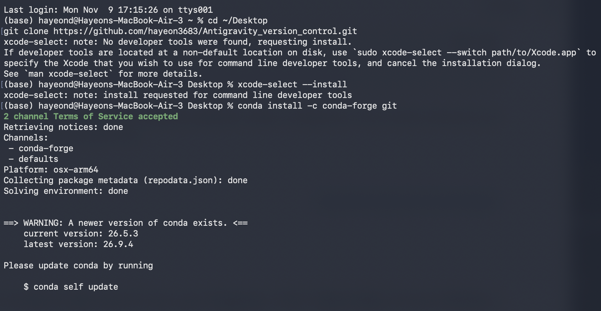
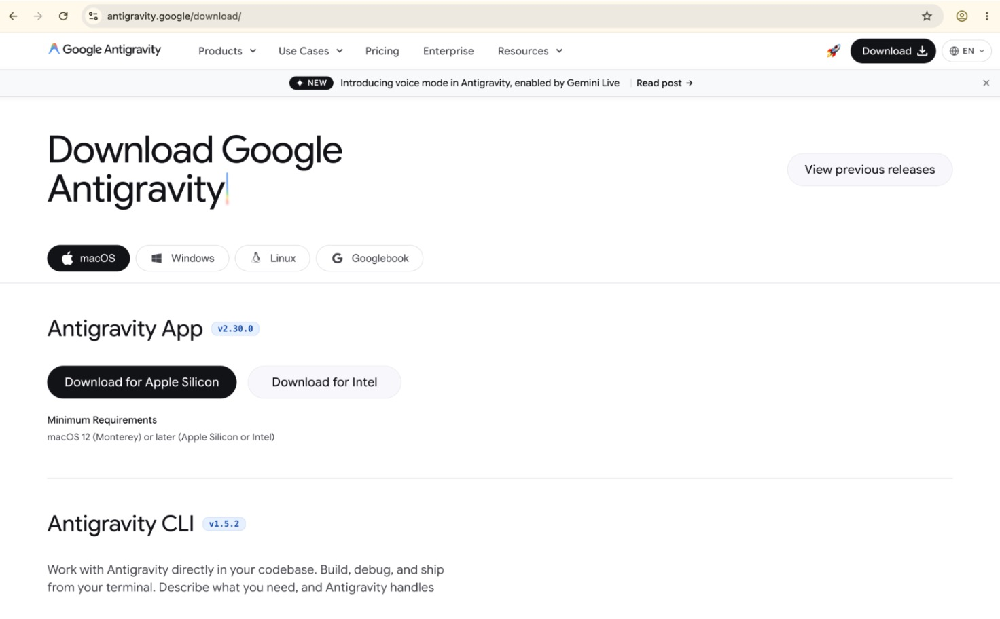
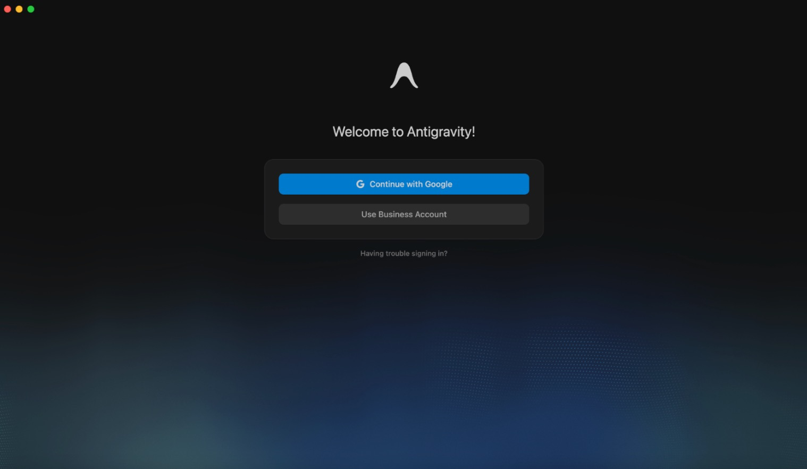
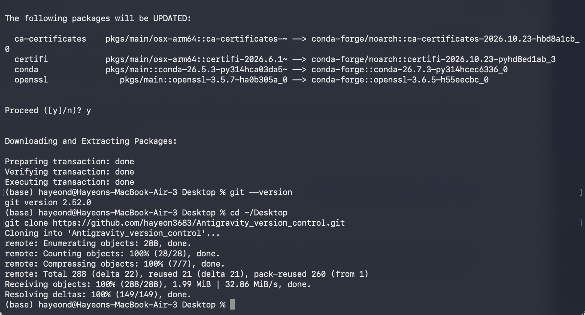
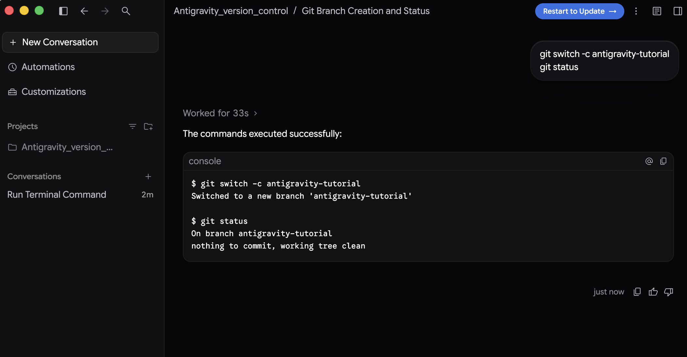
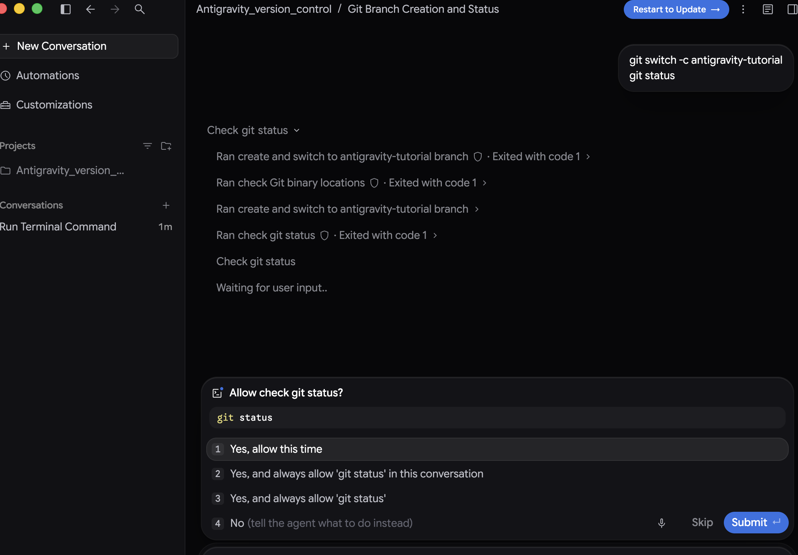
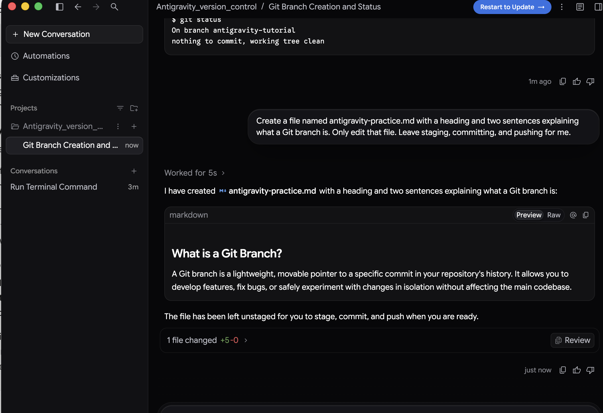
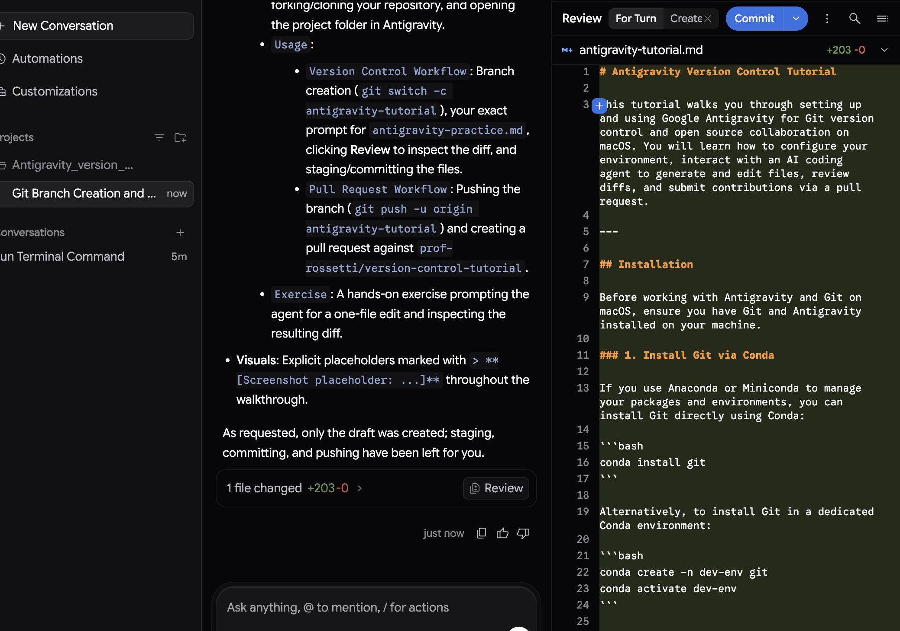

# Antigravity Version Control Tutorial

This tutorial walks you through setting up and using Google Antigravity for Git version control and open source collaboration on macOS. You will learn how to configure your environment, interact with an AI coding agent to generate and edit files, review diffs, and submit contributions via a pull request.

---

## Installation

Before working with Antigravity and Git on macOS, ensure you have Git and Antigravity installed on your machine.

### Install Git via Conda

If you use Anaconda or Miniconda to manage your packages and environments, you can install Git directly using Conda:

```bash
conda install git
```

Alternatively, to install Git in a dedicated Conda environment:

```bash
conda create -n dev-env git
conda activate dev-env
```

Verify that Git is installed properly and accessible:

```bash
git --version
```



### Install and set up Antigravity

Visit the [Antigravity Download page](https://antigravity.google/download/) and choose the installer for your computer. Once the package is downloaded, open the installer and move Antigravity to your `/Applications` directory.



Next, open Antigravity and follow the prompts to sign in with your Google account. Note that signing in to Antigravity with your Google account is for the IDE and AI agent; signing in to GitHub to push commits (`git push`) is a separate step that uses your GitHub credentials or SSH keys.



---

## Configuration

### 1. Configure Your Git Identity

Set your name and email address in your global Git configuration. These details identify you as the author of your commits:

```bash
git config --global user.name "Your Name"
git config --global user.email "your.email@example.com"
```

Verify your configuration settings:

```bash
git config --list
```

### 2. Fork and Clone the Repository

1. Visit the upstream repository on GitHub: [`prof-rossetti/version-control-tutorial`](https://github.com/prof-rossetti/version-control-tutorial).
2. Click the **Fork** button in the upper-right corner to create a copy under your personal GitHub account.
3. Open Terminal and clone your personal fork to your local machine:

```bash
git clone https://github.com/<your-username>/Antigravity_version_control.git
cd Antigravity_version_control
```

> *(Replace `<your-username>` with your GitHub username).*



### 3. Open the Project in Antigravity

1. Launch Antigravity.
2. Select **File > Open Folder...** (or click **Open Folder** on the welcome screen).
3. Navigate to and select the `Antigravity_version_control` folder you just cloned.

---

## Usage

Antigravity pairs an AI coding agent with a full development environment, allowing you to execute terminal commands, generate files through conversation, and visually review diffs before staging changes.

### Version Control Workflow

#### Step 1: Create and Switch to a Feature Branch

Always create a new branch for your work instead of working directly on `main`:

```bash
git switch -c antigravity-tutorial
git status
```

The output confirms that you are on the new branch:

```console
Switched to a new branch 'antigravity-tutorial'
On branch antigravity-tutorial
nothing to commit, working tree clean
```



When running terminal commands, Antigravity may prompt you with a command permission dialog to ensure you want to execute the command on your system. Click **Allow** (or **Always Allow**) to proceed:



#### Step 2: Prompt the Agent to Create a File

In the Antigravity chat panel, prompt the agent to create your initial practice file:

> **User Prompt:**
> ```text
> Create a file named antigravity-practice.md with a heading and two sentences explaining what a Git branch is. Only edit that file. Leave staging, committing, and pushing for me.
> ```



The agent will use its file-writing tools to generate `antigravity-practice.md` with the requested content.

#### Step 3: Review the Changes in Antigravity

Beneath the agent's response, click the **Review** button. This opens Antigravity's diff inspector, which highlights added, modified, or deleted lines in side-by-side or inline view.

1. Inspect the added lines to ensure they match your requirements.
2. Confirm that no unexpected files were modified.



#### Step 4: Stage and Commit Your Tutorial Files

Once you are satisfied with the generated files, switch to the terminal in Antigravity and check the status of your working tree:

```bash
git status
```

Stage the practice and tutorial files:

```bash
git add antigravity-practice.md antigravity-tutorial.md
```

Commit the staged changes with a descriptive message:

```bash
git commit -m "Add antigravity tutorial and practice files"
```

Verify the working tree is clean:

```bash
git status
```

> **[Screenshot placeholder: Terminal showing `git add`, `git commit`, and a clean working tree]**

---

### Pull Request Workflow

#### Step 1: Push the Branch to Your Fork

Push your feature branch to your GitHub fork (`origin`):

```bash
git push -u origin antigravity-tutorial
```

The `-u` (or `--set-upstream`) flag links your local `antigravity-tutorial` branch to the remote branch on your fork so future pushes only require `git push`.

> **[Screenshot placeholder: Terminal output confirming the branch was pushed to remote]**

#### Step 2: Open a Pull Request

1. Open your web browser and navigate to your GitHub fork or the upstream repository at [`prof-rossetti/version-control-tutorial`](https://github.com/prof-rossetti/version-control-tutorial).
2. GitHub will typically show a banner stating `antigravity-tutorial had recent pushes`. Click **Compare & pull request**.
   *(If the banner does not appear, go to the **Pull requests** tab and click **New pull request**).*
3. Set the base and compare branches:
   - **Base repository:** `prof-rossetti/version-control-tutorial`
   - **Base branch:** `main`
   - **Head repository:** `<your-username>/Antigravity_version_control`
   - **Compare branch:** `antigravity-tutorial`
4. Add a descriptive title (e.g., `Add Antigravity tutorial and practice guide`) and summarize your changes in the description comment box.
5. Click **Create pull request**.

> **[Screenshot placeholder: GitHub Pull Request creation page comparing `prof-rossetti:main` with `<your-username>:antigravity-tutorial`]**

---

## Exercise

Now practice working collaboratively with the Antigravity agent by having it perform an edit on an existing file:

1. **Prompt the Agent:** Ask the agent to perform a specific, single-file edit on `antigravity-practice.md`. For example:
   > *"In `antigravity-practice.md`, add a blockquote tip at the bottom explaining the difference between `git branch` and `git switch`."*
2. **Review the Diff:** Beneath the agent's response, click **Review**.
3. **Verify:**
   - Did the agent only modify `antigravity-practice.md`?
   - Are the existing two sentences and heading preserved?
   - Do the green additions reflect exactly what you requested?
4. **Stage and Commit:** Once confirmed, use `git status`, `git add antigravity-practice.md`, and `git commit -m "Add tip to antigravity-practice.md"` to finalize your changes.

> **[Screenshot placeholder: Diff review showing the new blockquote addition in `antigravity-practice.md`]**
