# Cursor Tutorial

Cursor is an AI code editor built on top of Visual Studio Code. You describe what you want in plain English in the **Agent** panel, and Cursor's agent reads your project, edits files, and proposes terminal commands. This chapter shows how to install and configure Cursor, then use it for the **version control** and **pull request** workflows.

> **Note:** Cursor works with a free account on the **Hobby** plan, but free usage is limited. Agent requests and Tab completions are capped, and Cursor does not publish an exact number. You can see how much you have used on your account dashboard at <https://cursor.com/dashboard>. If you hit a limit, wait for it to reset and continue later.

## Installation

Official Website: [Cursor](https://cursor.com) · Documentation: [Cursor Docs](https://cursor.com/docs)

This chapter uses a Mac. Windows steps are given wherever they differ. Keyboard shortcuts are written Mac first, for example Cmd + L (Ctrl + L on Windows).

> **Using GitHub Desktop?** You still need git installed. GitHub Desktop keeps its own private copy of git that Cursor and the terminal cannot use, and Cursor's agent runs git commands in the terminal.

**Before you start**, check that git is installed.

**Mac**

1. Open the Terminal app: press Cmd + Space, type **Terminal**, and press Enter.

   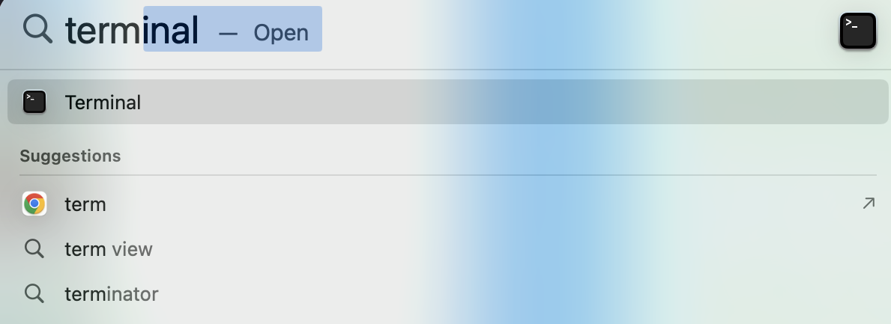

2. Type the following command and press Enter:
```
   git --version
```

   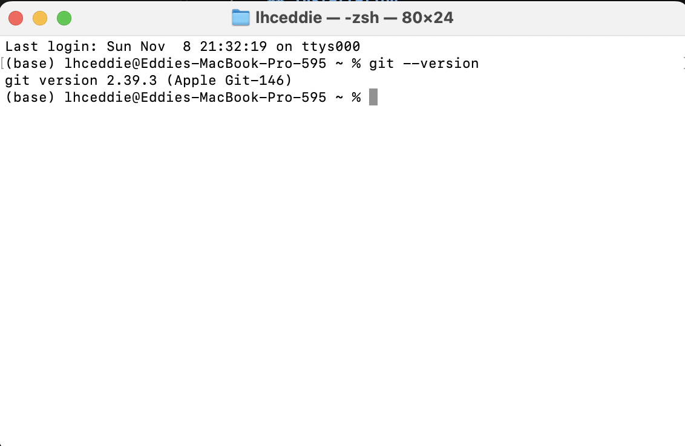

3. If a version number prints, git is installed. If not, macOS shows a window offering to install the **command line developer tools**. Click **Install**, wait for it to finish, then run `git --version` again.

   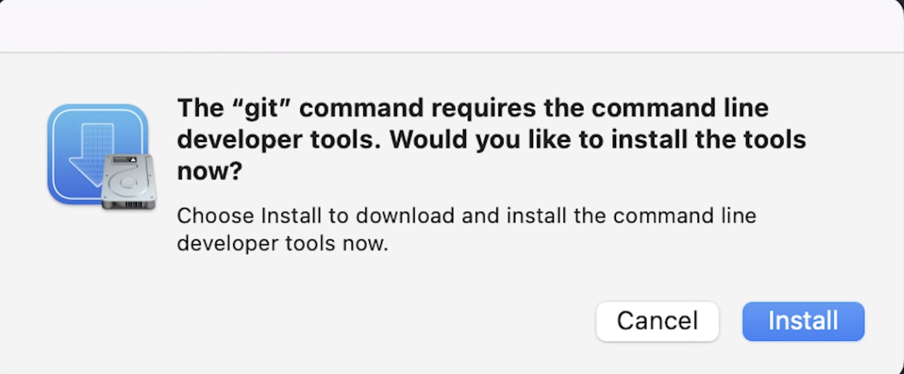

**Windows**

1. Click the Windows button and type **PowerShell** to open it.


2. Type the following command and press Enter:
```
   git --version
```

3. If this prints "command not found," install git from <https://git-scm.com>, then open a new PowerShell window and run the same command again to recheck.


**Install Cursor**

**Mac**

1. Go to <https://cursor.com/download> and download the Mac version.

   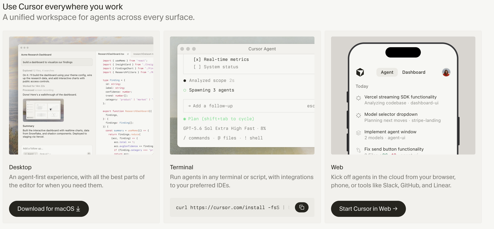

2. Open the downloaded `.dmg` file and drag **Cursor** into the **Applications** folder.

   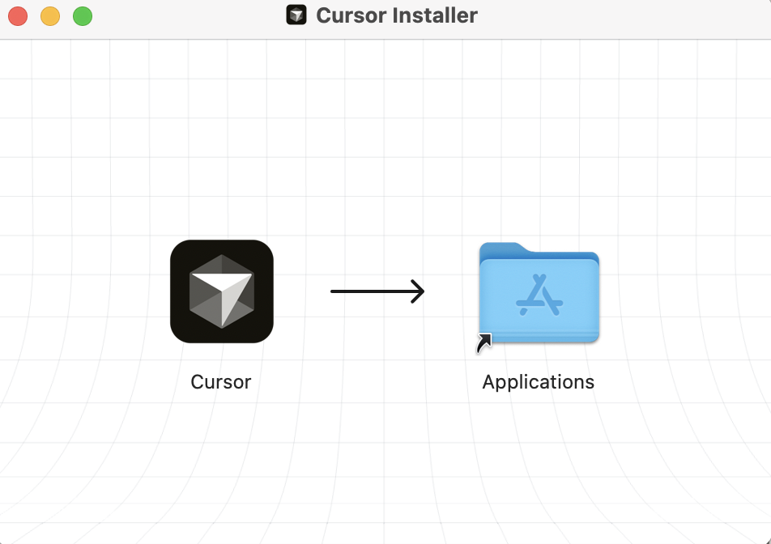


**Windows**

1. Go to <https://cursor.com/download> and download the Windows installer.
2. Run the installer and follow the prompts.

**Check that it worked:**

Open Cursor from the Applications folder or Launchpad (Mac), or from the Start menu (Windows). If the welcome screen appears, Cursor is installed.

**Troubleshooting**

- On a Mac, if you see "Cursor is an app downloaded from the Internet. Are you sure you want to open it?", click **Open**.
- On first launch, Cursor may offer to import your VS Code settings and extensions. Either choice is fine for this walkthrough.
- If Cursor does not open on Windows, restart your computer and try again.

## Configuration

Two separate logins are needed:

| Login | What it is for | How to set it up |
|---|---|---|
| Cursor login | Lets Cursor's agent (the AI) work for you | Sign in when Cursor first starts |
| GitHub login | Lets your computer push to GitHub and open pull requests | `gh auth login` |

Cursor's agent does not have its own "connect GitHub" button for this workflow. When you ask the agent to commit, push, or open a pull request, it runs the same git and GitHub commands you could run yourself in the terminal, using the GitHub login on your computer. So linking Cursor to GitHub means setting up git and the GitHub CLI as shown below.

### Sign in to Cursor

1. Open Cursor.
2. Click **Sign Up** or **Log In** on the welcome screen.
3. A browser window opens. Create a free account (or log in with Google or GitHub) and approve access.

   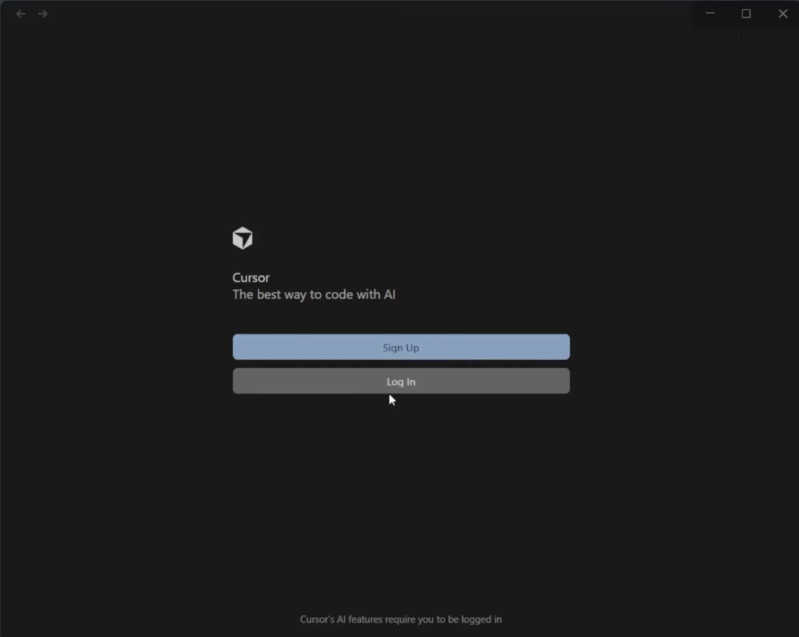

4. Return to Cursor. When you see your account at the bottom left of the panel, Cursor is ready.

### Tell git who you are

Every commit is stamped with a name and email. Check whether they are set to your personal information by typing the following in the terminal:

```
git config --global user.name
git config --global user.email
```

If either prints nothing, set them (use the email tied to your GitHub account):

```
git config --global user.name "Your Name"
git config --global user.email "you@example.com"
```

### Log your computer in to GitHub

This step links your computer, and therefore Cursor, to your GitHub account. You'll do this with the GitHub CLI (`gh`), a small program that runs in the terminal. On Mac, the easiest way to install it is with Homebrew, a free tool for installing software from the terminal.

1. Install the GitHub CLI
   
   **Mac**:
   1. Install Homebrew. Go to the website <https://brew.sh/> and copy the command in your terminal
      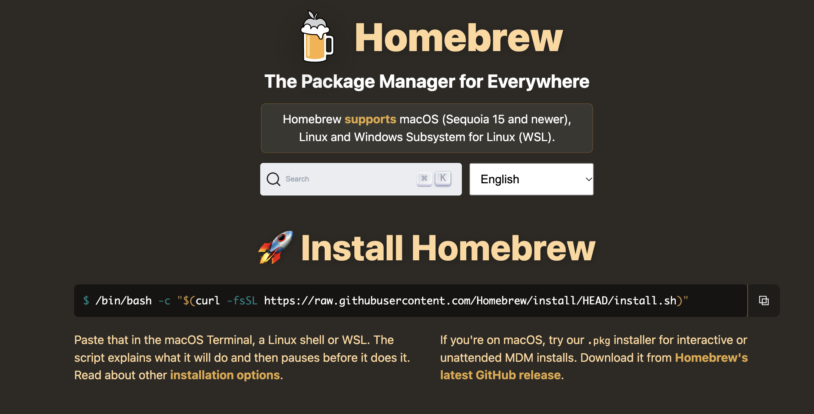

   2. Enter your Mac password when asked (nothing appears as you type), then press Enter again to continue. If your Mac asks to install the "Command Line Developer Tools," click **Install** and wait for it to finish. The whole install can take several minutes.

   3. When it finishes, Homebrew prints a **Next steps** section. If it lists commands under "Run these commands in your terminal to add Homebrew to your PATH," copy and run them. On most newer Macs they look like this:
       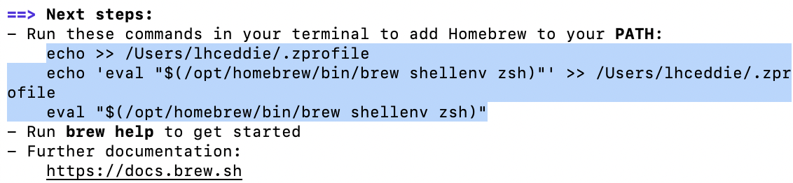


   4. Check that Homebrew works:
      ```
        brew --version
      ```
   5. Install the GitHub CLI:

      ```
         brew install gh
      ```
   **Windows**: `winget install --id GitHub.cli`, or download the installer from <https://cli.github.com>

2. Close and reopen the terminal (in Cursor, click the trash can icon on the terminal panel, then open a new one), then run `gh --version` to confirm.

3. Run:
   ```
   gh auth login
   ```

4. Answer the questions:
   - *Where do you use GitHub?* **GitHub.com**
   - *How would you like to authenticate GitHub CLI?* **Login with a web browser**
   - *What is your preferred protocol for Git operations?* **HTTPS**
   - *Authenticate Git with your GitHub credentials?* **Yes**
   - *How would you like to authenticate GitHub CLI?* **Login with a web browser**
5. Copy the one-time code shown in the terminal, press Enter, and paste the code into the GitHub page that opens in your browser. Click **Continue**, then **Authorize**.

   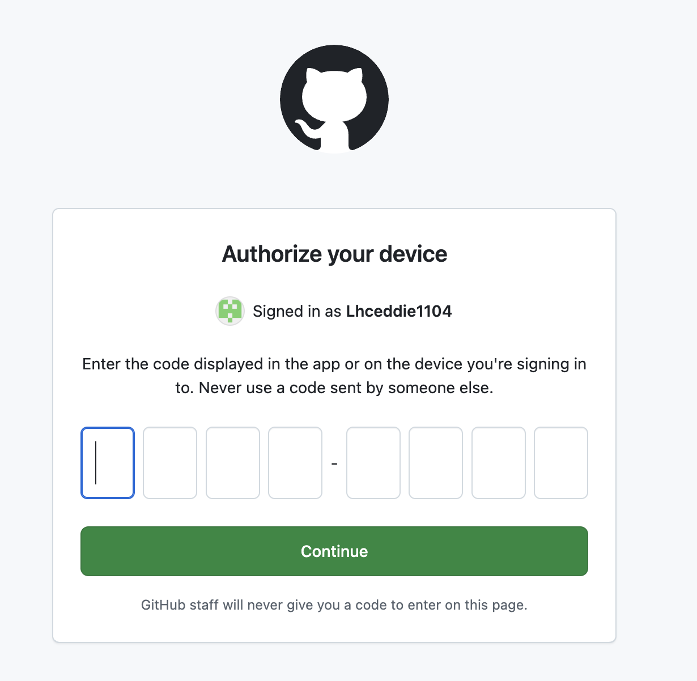
   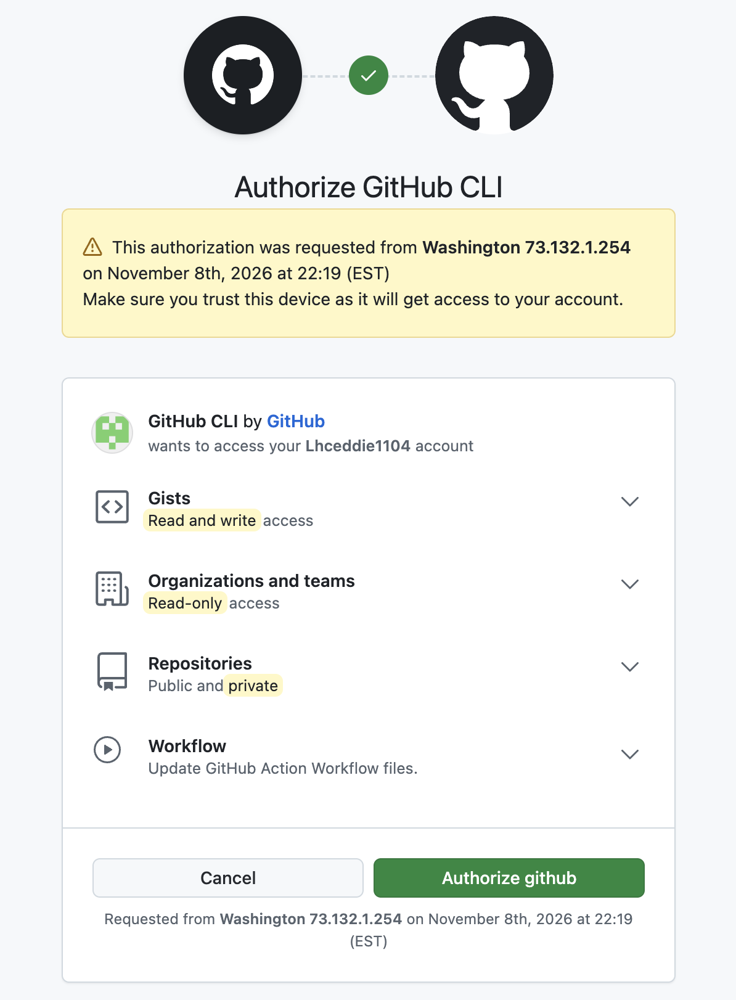


6. Verify the login:
```
   gh auth status
```

   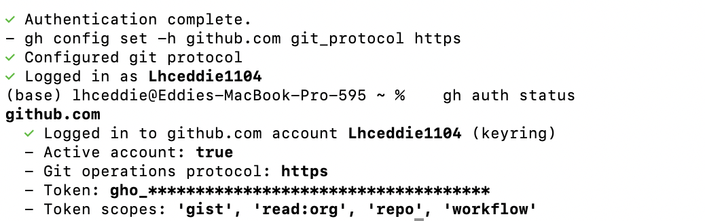

### Create a practice repository

The workflows below need a GitHub repository to push to. Create a new practice repository on your own account so nothing affects any real project.

1. In Cursor, open the built-in terminal with **File > New Terminal** (or Ctrl + \` on both Mac and Windows).
2. Go to the folder where you keep projects (for example `cd ~/Documents` on Mac, `cd ~\Documents` on Windows), then run:
```
   gh repo create cursor-practice --public --add-readme --clone
```

   This creates the repository titled "cursor-practice" on GitHub with a README, then downloads it to your computer.


3. Open the new folder in Cursor with **File > Open Folder** and choose `cursor-practice`. The terminal now starts inside the repository folder.
4. Check that it is linked to GitHub:
```
   git remote -v
```

   Two lines starting with `origin` and ending in `cursor-practice.git` mean it is set up.

### Make Cursor ask before running commands

By default, Cursor's agent edits files directly and asks before running terminal commands, but newer versions can let it approve some commands on its own. For this walkthrough, make sure it always asks:

1. Open **Cursor Settings** (gear icon in the top right, or Cmd + Shift + J on Mac, Ctrl + Shift + J on Windows).
2. Go to **Agents** and find **Run Mode**.
3. Choose the option that asks for approval before every command. Never choose a "Run Everything" option.

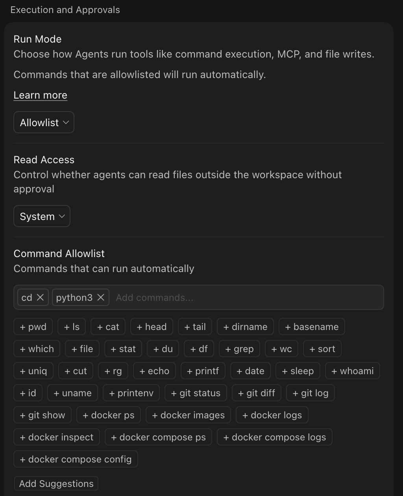

### Where Cursor keeps its settings

Cursor stores its settings in its own app folders and in the `.cursor` folder in your home folder (`~/.cursor` on Mac, `C:\Users\<you>\.cursor` on Windows). On a Mac this folder is hidden in Finder; press Cmd + Shift + . to show hidden files. No changes are needed for this walkthrough. Never copy anything from the `~/.cursor` folder into a repository, because it can contain login information.

## Usage

The workflows below use a practice branch inside your `cursor-practice` repository. Simple steps are typed directly with git in Cursor's terminal, and the agent is used for the steps that show what it can do.

### Version Control Workflow

1. **Create a branch (typed directly).** In Cursor's terminal:
```
   git checkout -b cursor-practice
```

   Git replies "Switched to a new branch."

   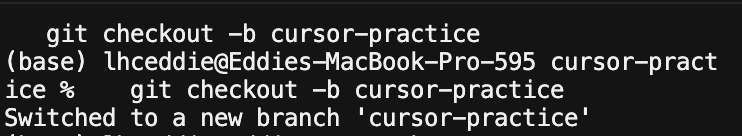

2. **Open the Agent panel.** Press Cmd + L (Ctrl + L on Windows), or click the chat icon in the top right. Check that the mode dropdown at the bottom of the panel says **Agent**.

   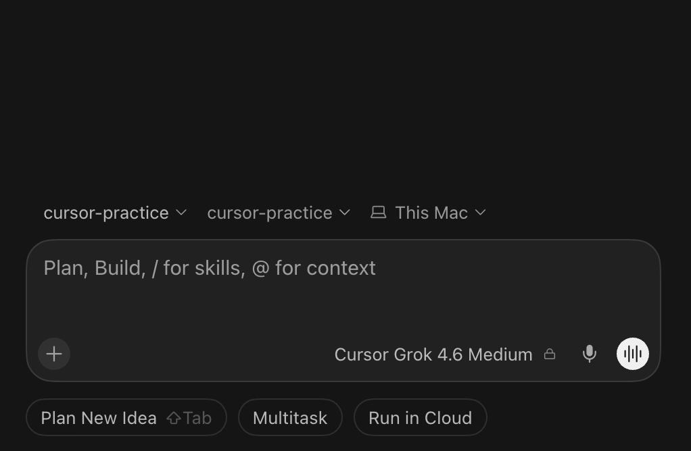

3. **Ask Cursor to create a file.** Type this prompt:
   > Create a file called cursor-test.md containing a short paragraph explaining what a git branch is.

   Cursor creates the file and shows the change in green. Unlike Codex, file edits are saved right away, so review them: click **Keep** to accept the change or **Undo** to reject it. This review step is an important safety feature.
     !(../images/Cursor_Screenshots/15.png)

4. **Look at what changed.** Type this prompt:
   > Run git status and show me the diff.

   Cursor shows the command it wants to run and waits for you to click **Run**. `git status` lists the files that changed. A diff shows exactly which lines were added or removed. You can also see the changes in the **Source Control** panel on the left (the branch icon).
5. **Ask Cursor to commit.** Type this prompt:
   > Stage cursor-test.md and commit it with the message "Add cursor test file".

   Staging marks a file to be included in the next snapshot, and committing takes the snapshot. Click **Run** on each command after reading it.

6. **Push the branch to GitHub (typed directly).**
```
   git push -u origin cursor-practice
```

7. **Confirm on GitHub.** Open your `cursor-practice` repository on GitHub, use the branch dropdown to switch to `cursor-practice`, and check that `cursor-test.md` is listed.


### Pull Request Workflow

This practice pull request is opened inside your own `cursor-practice` repository.

1. **Ask Cursor to open the pull request.** Start a new chat in the Agent panel (the **+** button) and type this prompt:
   > Use the GitHub CLI to open a pull request from the current branch into main. Write a clear title and a short description.

   Click **Run** on the commands. Cursor runs `gh pr create`.    If Cursor has trouble, run the command yourself in the terminal:
```
   gh pr create --base main --head cursor-practice --title "Add Cursor test file" --body "Practice pull request."
```

   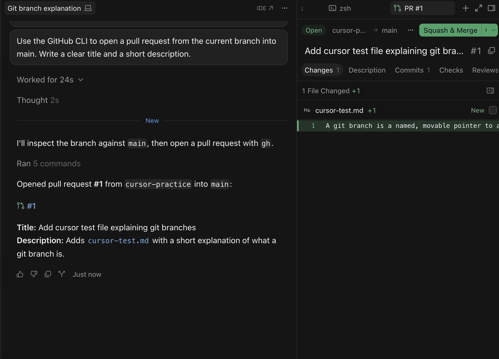

2. **View the pull request on GitHub.** Open the link that was printed, or go to the **Pull requests** tab of your `cursor-practice` repository on GitHub. Check the title, description, and the **Files changed** tab.

   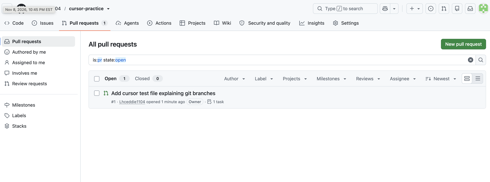

3. **Squash and Merge**  Cursor can directly squash and merge your pull requests. You can do so by clicking the "squash and merge" button in the cursor agent tab above

## Tips and troubleshooting

- **Plan your prompts.** On the free Hobby plan, write prompts in advance and keep them short and specific to save usage.
- **Review before approving.** Cursor saves file edits immediately and asks before running commands. Read each change and command before you click **Keep** or **Run**.
- **Undo a bad change.** Each agent message has a checkpoint. Use **Restore Checkpoint** above your prompt to roll the files back to how they were before that request.
- **Agent only answers and does not edit.** Check that the mode dropdown says **Agent**, not **Ask** or **Plan**.
- **Authentication errors on push.** Run `gh auth login` again, then `gh auth status`.
- **`fatal: not a git repository`.** Cursor has the wrong folder open. Use **File > Open Folder** and choose the `cursor-practice` folder.
- **`gh repo create` says the name already exists.** You already have a repository called `cursor-practice`. Pick another name, such as `cursor-practice-2`, and use it in place of `cursor-practice` throughout.
